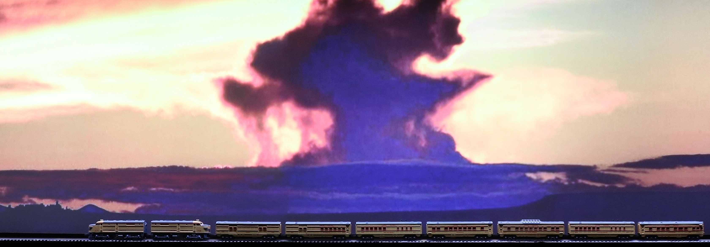

# Model-Train-Lighting

.

It's always intrigued me why model railroaders don't take more advantage of targeted lighting on their railroads.  So often the mode of operation is to turn the ceiling lights on and then run the trains.  With modern LED strips and inexpensive electronics, any DIYer can take a very different approach: assume you're starting with a dark room and then use electronically controlled lighting to highlight only those activities you want highlighted at any particular moment.  That's how theater lighting experts do it.  It can add a whole new dimension to a model railroad!

In the image above, the train would be only a black silhouette against the projected backdrop without the use of an LED strip-lit slit GOBO placed above it.

In early 2026 I had a paper, "Lighting for Effect," on this topic accepted by Model Railroader Magazine (https://www.trains.com/mrr/).  Watch for it in the near future.  Also in early 2026 I had a paper, "Dynamic Scene Projection," accepted by Model Railroader Magazine (https://www.trains.com/mrr/).  Watch for it in the near future. The scene in the image above is a combination of dynamic scene projection (https://github.com/pfr/Dynamic-Scene-Projection) and carefully controlled lighting. 

Code and other material here was created by me to support my deployment of targeted lighting.  Here there are hardware designs for building your own wireless controllers for both analog LED strips (use PWM to control light intensity) and addressable LED strips with individual segment control (Sometimes called RBCIC or SPI strips). I've used Raspberry Pi Pico 2w's for primary control. The code for them is included here as well.  I've also included the software I use to wirelessly communicate with these controllers to make them perform their functions.

